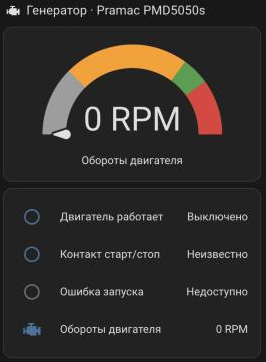
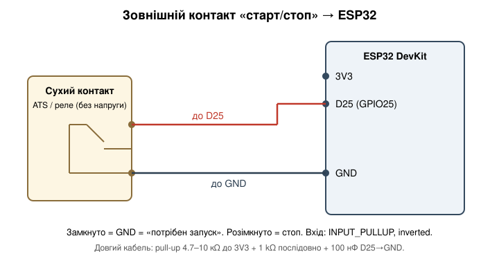
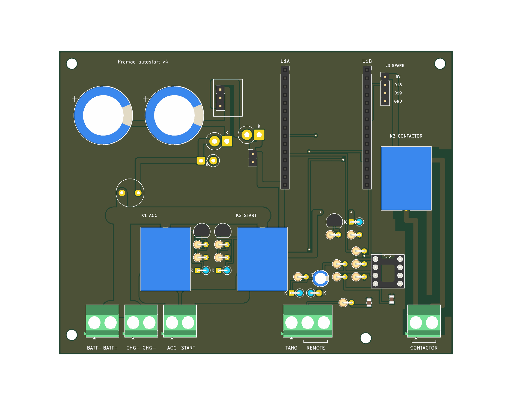
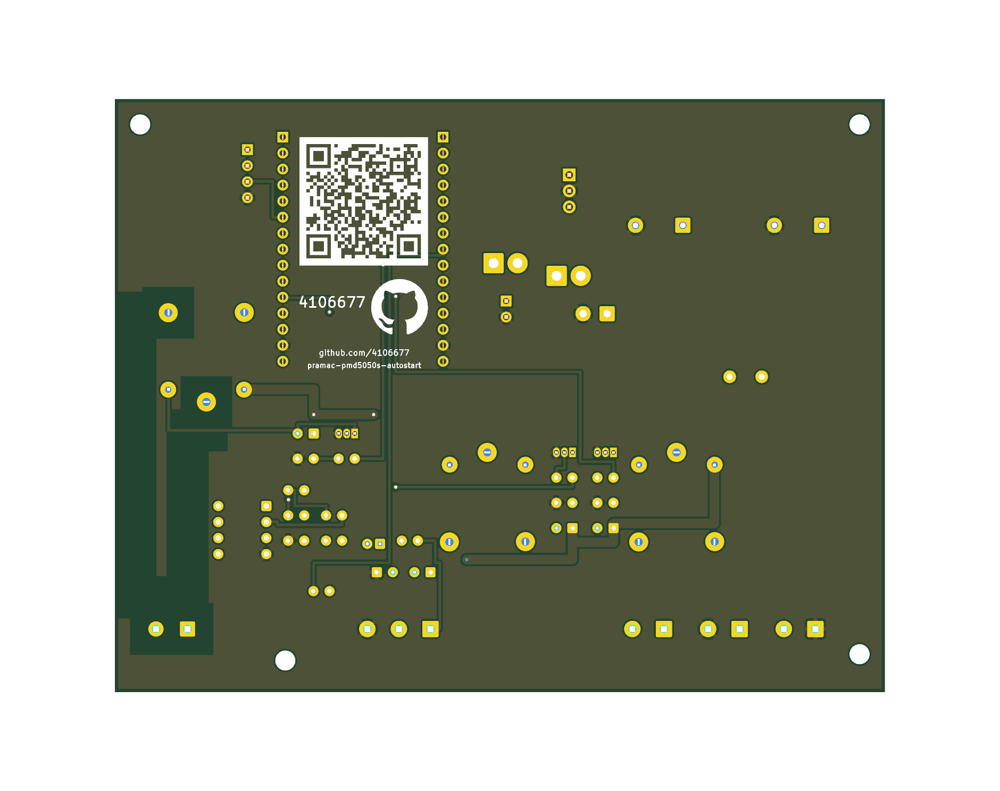

# Pramac PMD5050S — автозапуск на ESP32 (ESPHome)

Заміна штатного блоку автозапуску (ATS) для генератора **Pramac PMD5050S** (дизель 186FA, 50 Гц ≈ 3000 об/хв) на ESP32 з ESPHome та Home Assistant.

> ⚠️ Це реальний генератор зі стартером: безпека важливіша за швидкість. Проєкт — для особистого використання, без гарантій. Використовуєте на свій ризик.



## Як працює
- Зовнішні сухі контакти замкнулись → подається **ACC**, стартер крутиться до появи обертів (до 3 спроб), ACC тримається, поки контакти не розімкнуться.
- Оберти беруться з сигналу **TAHO** (допоміжна обмотка маховика) через LM393 на піні D14; ≈6 імпульсів/оберт, ~18 300 імп/хв ≈ 3 050 об/хв.
- Поріг «двигун працює» — 1000 об/хв.
- Лічильник **моточасів** (`duty_time`, зберігається у флеші, старт з нуля).
- У логах оберти пишуться тільки коли вони не 0.

## Підключення
| Пін | Призначення |
|---|---|
| D14 (GPIO14) | TAHO (вихід LM393 → `pulse_counter`) |
| D25 (GPIO25) | зовнішній контакт старт/стоп, `INPUT_PULLUP`, замкнуто = GND |
| D2 (GPIO2) | реле ACC |
| D4 (GPIO4) | реле START |



Захист TAHO: Taho → R1 10 кΩ → два стабілітрони BZX55C5V1 зустрічно на GND → C3 10 мкФ (неполярний) → LM393 IN−, зсув 1.65 В, гістерезис R4 100 кΩ, pull-up R5 на 3V3. Живий дріт Taho **не можна** садити на масу.

## Прошивка
```bash
cd esphome
cp secrets.yaml.example secrets.yaml   # заповніть
esphome config pramac-pmd5050s.yaml
esphome compile pramac-pmd5050s.yaml
```
ESPHome 2025.4.1. Константи `pulses_per_rev` та `running_rpm_threshold` — у `substitutions`.

## Home Assistant
Картка зі шкалою обертів: [`homeassistant/generator-card.yaml`](homeassistant/generator-card.yaml) (замініть entity_id на свої).

## Плата (KiCad, v4)
Плата-носій 122×94 мм, 2 шари, суцільна земля, DRC без електричних порушень (KiCad 10.0.6). Файли — в [`hardware/`](hardware/):
`pramac_carrier.kicad_pcb`, `pramac_carrier_gerbers.zip` (для PCBWay), `fit_check_1to1.pdf` (роздрукувати 1:1 і приміряти), [`BOM.md`](hardware/BOM.md) (повний список компонентів), `pramac_carrier.kicad_dru` (правило зазору 2,5 мм для мережевих ланцюгів), `generate_board.py` + `qr.txt` (генератор плати через `pcbnew`).




- **Клеми (DG128-5.0, всі з одного боку):** BATT− BATT+ | CHG+ CHG− (зарядний паралельно входу, до запобіжника) | ACC, START (виходи реле NO, +12 В) | TAHO, REMOTE (2 контакти: сухий контакт інвертора) | CONTACTOR (2 контакти: сухі COM/NO реле K3 під котушку контактора 230 В).
- **Живлення:** запобіжник T 2 А (радіальний KLS5-102-5RT-020H) → TVS → 1N5821 → C1/C2 → DC-DC Favotek RM20S-050 (5 В 2 А) → 1N5821 → вузол 5 В (+ іоністор SC1).
- **Реле на платі:** 3× SRD-05VDC-SL-A (K1 ACC, K2 START, K3 контактор), драйвер BC337 з підтяжкою бази 10 кОм до GND (реле вимкнені при завантаженні ESP32). +12 В до COM K1/K2 шиною 5 мм, виходи NO по 4 мм (≈10 А). Для цієї плати `inverted: false` у прошивці.
- **ESP32 DevKit V1 30-pin** вставляється в **прямі** гнізда 1×15 (відстань між рядами 25,4 мм).
- **J3** — резервний роз'єм під зовнішній модуль реле (5V, D18, D19, GND), у прошивці не використовується.
- На нижньому боці: QR на цей репозиторій, логотип GitHub і нік.

### Сценарій контактора
Запуск (Remote замкнений або «Запуск з HA») → ACC → стартер → двигун виходить на оберти → **40 с прогріву** → замикається K3 (контактор подає навантаження). **СТОП**: спершу розмикається K3, через **3 с** знімається ACC. Несподівана зупинка двигуна одразу розмикає K3. Час прогріву й охолодження — `warmup_s`, `cooldown_s` у `substitutions`.

⚠️ **Не перевірено на залізі:** відстань між рядами ESP32, розпіновка D-підписів вашого DevKit, розпіновка клемників (за datasheet), зазори мережевого ланцюга контактора. Спочатку роздрукуйте `fit_check_1to1.pdf` без масштабування. Схеми `.kicad_sch` поки немає, плата зібрана з нетлисту в скрипті.

## Жорсткі правила
- Дріт START підключати до генератора **останнім**, після перевірки, що реле вимкнені під час завантаження.
- Не додавати логіку, яка вмикає START, коли двигун міг уже крутитися.
- Знятий ACC = двигун глухне (реле ACC вимикається при перезавантаженні плати — свідомий компроміс).
- Захист TAHO не послаблювати без обговорення.

## Відкрите
- Звірити `pulses_per_rev`: частота на виході генератора (Гц) × 60 = об/хв.
- Перевірити, що реле вимкнені після завантаження (інакше `inverted: true`). GPIO2 — strapping-пін.
- Brownout під час старту Wi-Fi: перевірити 5 В на VIN ESP32.
- Рівень пального — пізніше.
