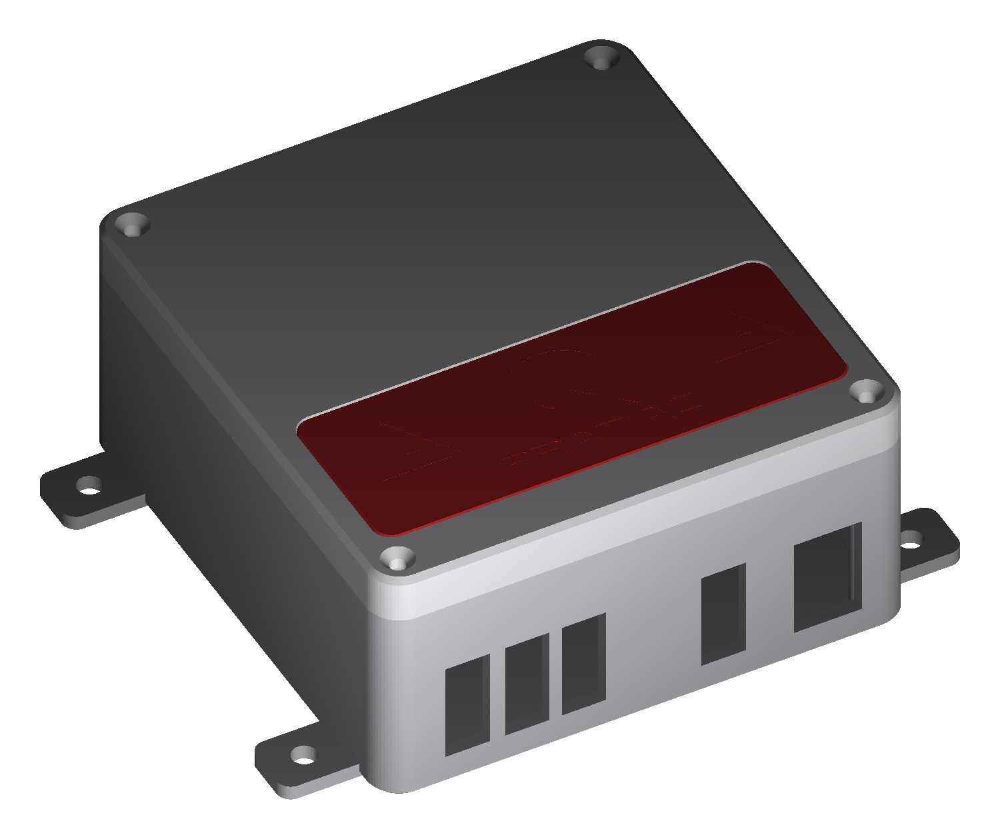

# Pramac PMD5050S — автозапуск на ESP32 (ESPHome)

Заміна штатного блоку автозапуску (ATS) для дизель-генератора **Pramac PMD5050S** (двигун 186FA, 50 Гц ≈ 3000 об/хв): плата-носій на KiCad + прошивка ESPHome + картка Home Assistant.

> ⚠️ Це реальний генератор зі стартером і мережева напруга 230 В на виході контактора. Безпека важливіша за швидкість. Проєкт особистий, без гарантій; використовуєте на свій ризик.

| Плата, верх | Плата, низ | Home Assistant |
|---|---|---|
|  |  |  |

## Що вміє
- **Автозапуск** по сухому контакту REMOTE (інвертор/ATS) або перемикачу «Запуск з HA»: подає ACC, крутить стартер до появи обертів (до 3 спроб), тримає ACC, поки запит активний.
- **Контактор з прогрівом:** після запуску чекає **40 с**, потім замикає реле K3 (сухі COM/NO під котушку контактора 230 В). На **СТОП** спершу розмикає K3, через **3 с** знімає ACC. Несподівана зупинка двигуна одразу розмикає K3. Час задається `warmup_s`, `cooldown_s`.
- **Оберти** з сигналу TAHO (допоміжна обмотка маховика) через LM393: ~18 300 імп/хв ≈ 3 050 об/хв при 6 імп/оберт. Поріг «двигун працює» 1000 об/хв.
- **Моточаси** (`duty_time`, зберігаються у флеші, старт з нуля), логування обертів лише коли вони ≠ 0.
- **Безпечні стани:** після перезавантаження плати всі реле вимкнені (NPN-драйвер з підтяжкою бази до GND), запит з HA скидається, двигун сам не стартує.

## Плата (KiCad 10, 93,2 × 82 мм, 2 шари)
Файли в [`hardware/`](hardware/):

| Файл | Призначення |
|---|---|
| `pramac_carrier.kicad_pcb` | плата (відкривається в KiCad PCB Editor) |
| `pramac_carrier_gerbers.zip` | Gerber + drill для виробника |
| `fit_check_1to1.pdf` | креслення 1:1, роздрукувати без масштабу й приміряти ESP32 та клеми |
| `BOM.md` | повний список компонентів |
| `pramac_carrier.kicad_dru` | правило зазору 2,5 мм для мережевих ланцюгів контактора |
| `generate_board.py`, `qr.txt` | генератор плати через `pcbnew` |

### Клеми (DG128-5.0, всі з одного боку)
`BATT−  BATT+` | `CHG+  CHG−` (зарядний паралельно входу, до запобіжника) | `ACC  START` (виходи реле NO, +12 В) | `CONTACTOR` (сухі COM/NO реле K3, 230 В) | `TAHO  REMOTE` (REMOTE — два контакти сухого контакту).

### Живлення і реле
- Запобіжник T 2 А (радіальний KLS5-102-5RT-020H) → TVS → 1N5821 → C1/C2 (2× 4700 мкФ) → DC-DC Favotek RM20S-050 (5 В 2 А) → 1N5821 → вузол 5 В (+ іоністор SC1).
- Реле: 3× SRD-05VDC-SL-A. K1 (ACC), K2 (START): COM до +12 В шиною 5 мм, NO на клему доріжкою 4 мм (≈10 А). Шина +12 В йде **до** запобіжника, тому на проводі від АКБ потрібен окремий зовнішній запобіжник (~15 А).
- Драйвер кожного реле: BC337 + резистор бази 1 кОм + підтяжка бази 10 кОм до GND + діод 1N4148 на котушці.

### ESP32
DevKit V1 30-pin **лежить горизонтально** (антена ліворуч, USB праворуч), вставляється в прямі гнізда 1×15 (відстань між рядами 25,4 мм). Під антеною немає міді, під модулем стоять лише низькі деталі.

| Пін | Призначення |
|---|---|
| D14 | TAHO (вихід LM393 → `pulse_counter`) |
| D25 | REMOTE, `INPUT_PULLUP`, замкнуто = GND (через R6 1 кОм, фільтр C6) |
| D2 / D4 / D26 | реле ACC / START / контактор (активний HIGH) |
| D27, D13 | резервний роз'єм J3 (не використовується в прошивці) |

### Вхід TAHO
Taho → R1 22 кОм → два стабілітрони BZX55C5V1 зустрічно на GND → C3 10 мкФ (неполярний) → LM393 IN−; зсув 1,65 В дільником 10 кОм/10 кОм, гістерезис R4 100 кОм, pull-up R5 4,7 кОм на 3V3. Живий дріт Taho **не можна** садити на масу.

### Нижній бік
QR на цей репозиторій, логотип GitHub і нік.

## Прошивка
```bash
cd esphome
cp secrets.yaml.example secrets.yaml   # заповніть своїми значеннями
esphome config pramac-pmd5050s.yaml
esphome compile pramac-pmd5050s.yaml
```
ESPHome 2025.4.1. Константи: `pulses_per_rev`, `running_rpm_threshold`, `warmup_s`, `cooldown_s` у `substitutions`. Для цієї плати реле мають `inverted: false`.

## Home Assistant
Картка зі шкалою обертів і перемикачем: [`homeassistant/generator-card.yaml`](homeassistant/generator-card.yaml) (замініть entity_id на свої; для перемикача «Запуск з HA» варто увімкнути підтвердження натискання).

## Корпус для друку (ABS)
Основа + кришка + червона вставка з логотипом Pramac (без гвинтів, на клею), додаткові опори й напрямні для плати, кріплення на стіну вушками, кришка на M3 з латунними вставками. Параметрична модель: [`enclosure/`](enclosure/) (STL, скрипт для Fusion, генератор на Python, інструкція).



## Замовлення плати
Для PCBWay: 2 шари, 1,6 мм, мідь **2 oz** (шина 10 А), HASL без свинцю, файл `pramac_carrier_gerbers.zip`. Майже всі компоненти виводні (THT), тож плату зручно паяти вручну; готові модулі (ESP32 DevKit, RM20S) ставляться як є.

## Порядок першого запуску
1. Роздрукувати `fit_check_1to1.pdf` 1:1, приміряти ESP32, колодки, клеми (відстань між рядами, висота під модулем ~8,5 мм).
2. Зібрати плату без ESP32, перевірити 5 В і 3,3 В, TVS/запобіжник.
3. Прошити, перевірити, що **всі три реле вимкнені** при подачі живлення й після кількох перезавантажень.
4. Перевірити TAHO на працюючому двигуні (~3 050 об/хв), звірити `pulses_per_rev` (частота на виході × 60).
5. Дріт **START до генератора підключати останнім**.
6. Контактор перевірити окремо без навантаження (прогрів 40 с, СТОП: K3 розмикається, через 3 с ACC).

## Жорсткі правила
- START підключати останнім, після перевірки, що реле вимкнені під час завантаження.
- Не додавати логіку, яка вмикає START, коли двигун міг уже крутитися.
- Знятий ACC = двигун глухне; реле ACC вимикається при перезавантаженні плати (свідомий компроміс).
- Захист TAHO не послаблювати без обговорення.
- Мережеві (230 В) ланцюги контактора перевіряти окремо: плата не сертифікована.

## Відкрите
- Звірити `pulses_per_rev` по частоті на виході генератора.
- Не перевірено на залізі: відстань між рядами ESP32, розпіновка D-підписів вашого DevKit, розпіновка клемників (за datasheet), зазори мережевого ланцюга.
- Brownout під час старту Wi-Fi: перевірити 5 В на VIN ESP32.
- Схеми `.kicad_sch` немає: плата зібрана з нетлисту в скрипті.
- Рівень пального: пізніше.
